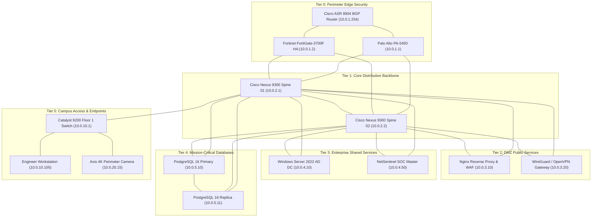

# NetSentinel Enterprise — Next-Generation Network Security & Telemetry Monitoring Platform (NMS / SIEM)

[](https://github.com/Mohammed-aichour/NetSentinel-Enterprise/actions)
[](https://www.python.org/)
[](LICENSE)
[](https://attack.mitre.org/)
[](Dockerfile)
[](https://mohammed-aichour.github.io/NetSentinel-Enterprise/)

> **NetSentinel Enterprise** is an enterprise-grade Network Management & Security Information and Event Management (NMS / SIEM) platform engineered for large-scale corporate data center and campus network infrastructures. Inspired by enterprise platforms like Zabbix, Wazuh, Prometheus, and Cisco DNA Center, it combines real-time network topology discovery, multi-protocol telemetry streaming, rule-based threat correlation, and stateful SOC incident orchestration into a unified cyber defense cockpit.

---

## 🌐 Live Interactive SOC Console Preview

Experience the real-time Cyber SOC Console directly in your browser:  
👉 **[Open Live NetSentinel SOC Dashboard](https://mohammed-aichour.github.io/NetSentinel-Enterprise/)**

*Includes interactive Canvas topology map, real-time telemetry streaming charts, and a built-in Cyber Attack Simulator.*

---

## 🏛️ Enterprise Multi-Tier Architecture

NetSentinel models and monitors an end-to-end corporate network topology across six distinct security tiers:



---

## ⚡ Core Capabilities

### 1. Multi-Protocol Telemetry Collector
* **Real ICMP Ping Engine:** Measures round-trip time (RTT), latency jitter, and interface packet loss.
* **TCP Socket Probes:** Verifies full 3-way handshakes against critical service ports (HTTP 80, HTTPS 443, SSH 22, DNS 53, PostgreSQL 5432).
* **Synthetic SNMP MIB-II Telemetry:** Simulates realistic stochastic bandwidth, CPU utilization, and packet rates tailored to each device's operational role.
* **Zero-External DB Dependency:** Persistent relational SQLite storage with Write-Ahead Logging (`WAL`) mode enabled.

### 2. SIEM Threat Correlation & MITRE ATT&CK Mapping
The correlation engine runs window-based behavioral analysis to detect multi-stage cyber attacks:

| Rule ID | Name | MITRE ATT&CK | Threshold / Trigger | Action |
| :--- | :--- | :--- | :--- | :--- |
| **`SEC-R001`** | **SSH Credential Brute-Force** | [T1110.001](https://attack.mitre.org/techniques/T1110/001/) | > 5 failed auths in 60s | Alerts SOC & flags host |
| **`SEC-R002`** | **Horizontal Port Sweep** | [T1046](https://attack.mitre.org/techniques/T1046/) | > 10 unique ports in 30s | Escalates incident to HIGH |
| **`SEC-R003`** | **Volumetric DDoS / Traffic Anomaly** | [T1498.001](https://attack.mitre.org/techniques/T1498/001/) | > 800 Mbps or > 40,000 PPS | Critical alert & auto-quarantine |
| **`SEC-R004`** | **Unauthorized Rogue MAC** | [T1200](https://attack.mitre.org/techniques/T1200/) | Unrecognized MAC on sensitive VLAN | Critical alert & switchport isolation |
| **`SEC-R005`** | **Core Link Flapping & Loss Burst** | `NMS-NET-01` | >= 4 state flaps in 60s or Loss > 10% | Stability warning & status degradation |

### 3. Cyber SOC Console & Attack Simulator
* **Interactive Canvas Topology:** Node-link network map with dynamic traffic pulses, tier column alignments, hover tooltips, and click-to-inspect drawers.
* **Real-Time Streaming Charts:** Smooth SVG/Canvas area charts tracking aggregate throughput, average latency, and interface drops with zero external CDN dependencies.
* **Attack Simulator:** 1-click execution of 5 realistic cyber scenarios: DDoS surges, SSH brute-force, horizontal port sweep, backbone link flapping, and rogue MAC injection.
* **Live Network Probe Panel:** Execute real OS ICMP Echo probes and TCP 3-way handshakes against target hosts directly from the SOC console.
* **Host Quarantine & Audit Trail:** 1-click software isolation with full audit compliance logging (`audit_log`).
* **Closed-Loop Health Auto-Recovery:** Automatically restores degraded device status (`ONLINE`) upon incident resolution.

---

## 📚 Complete Project Documentation

Comprehensive guides are available in the [`docs/`](docs/) directory:

- 📖 **[Guide Pédagogique & Architectural (Français)](docs/PROJECT_GUIDE.md)** — Explications approfondies de l'architecture, du fonctionnement du SIEM, de la boucle de remédiation, et de l'honnêteté technique.
- ⚙️ **[Guide d'Installation & Démarrage](docs/INSTALLATION.md)** — Instructions pas à pas pour Windows, Linux et macOS.
- 🧪 **[Guide de Validation & Tests Automatisés](docs/TESTING.md)** — Détail des 26 tests automatisés et de la validation de bout en bout.
- 📡 **[Catalogue de l'API REST v1](docs/API.md)** — Spécification complète des requêtes et réponses JSON pour tous les endpoints.
- 🛡️ **[Référentiel des Règles de Détection SIEM](docs/DETECTION_RULES.md)** — Analyse détaillée des règles SEC-R001 à SEC-R005 et mappage MITRE ATT&CK.

---

## 🚀 Quickstart & Installation

### Prerequisites
* Python 3.10+ (tested on Python 3.11, 3.12, 3.13)
* Standard networking tools (`ping`, `curl`)

### Method 1: Local Python Environment
```bash
# 1. Clone the repository
git clone https://github.com/Mohammed-aichour/NetSentinel-Enterprise.git
cd NetSentinel-Enterprise

# 2. Create and activate virtual environment
python -m venv .venv
source .venv/bin/activate       # On Linux/macOS
.\.venv\Scripts\Activate.ps1    # On Windows PowerShell

# 3. Install dependencies
pip install -r requirements.txt

# 4. Start NetSentinel Server
python run.py
```
Open your browser at **`http://localhost:5000/`** to access the SOC Console.

### Method 2: Docker / Docker Compose
```bash
# Build and run containerized platform
docker-compose up -d

# Check running status and health probe
docker ps
```

---

## 🧪 Automated Test Suite

The test suite thoroughly verifies network probes, telemetry collectors, threat correlation heuristics, alert state transitions, event ingestion, and REST API endpoints:

```bash
# Run pytest with verbose test discovery
pytest -v
```

### Verified Test Matrix (26/26 Passing — 100%):
```text
tests/test_alert_manager.py::TestAlertManager::test_alert_acknowledgment_and_resolution PASSED [  3%]
tests/test_alert_manager.py::TestAlertManager::test_alert_processing_and_deduplication PASSED [  7%]
tests/test_api.py::TestRestAPI::test_all_simulation_scenarios PASSED     [ 11%]
tests/test_api.py::TestRestAPI::test_audit_logs_endpoint PASSED          [ 15%]
tests/test_api.py::TestRestAPI::test_closed_loop_lifecycle PASSED        [ 19%]
tests/test_api.py::TestRestAPI::test_device_detail_endpoint PASSED       [ 23%]
tests/test_api.py::TestRestAPI::test_device_probe_endpoint PASSED        [ 26%]
tests/test_api.py::TestRestAPI::test_device_quarantine_toggle PASSED     [ 30%]
tests/test_api.py::TestRestAPI::test_devices_listing_and_filtering PASSED [ 34%]
tests/test_api.py::TestRestAPI::test_events_ingest_and_retrieval PASSED  [ 38%]
tests/test_api.py::TestRestAPI::test_health_endpoint PASSED              [ 42%]
tests/test_api.py::TestRestAPI::test_simulation_attack_endpoint PASSED   [ 46%]
tests/test_api.py::TestRestAPI::test_telemetry_live_endpoint PASSED      [ 50%]
tests/test_api.py::TestRestAPI::test_topology_endpoint PASSED            [ 53%]
tests/test_collector.py::TestNetworkCollector::test_local_telemetry_metrics PASSED [ 57%]
tests/test_collector.py::TestNetworkCollector::test_localhost_ping PASSED [ 61%]
tests/test_collector.py::TestNetworkCollector::test_quarantined_device_telemetry PASSED [ 65%]
tests/test_collector.py::TestNetworkCollector::test_synthetic_device_telemetry_firewall PASSED [ 69%]
tests/test_collector.py::TestNetworkCollector::test_tcp_port_probe_refused PASSED [ 73%]
tests/test_collector.py::TestNetworkCollector::test_unreachable_ping PASSED [ 76%]
tests/test_correlator.py::TestEventCorrelator::test_interface_flapping_detection PASSED [ 80%]
tests/test_correlator.py::TestEventCorrelator::test_port_scan_detection PASSED [ 84%]
tests/test_correlator.py::TestEventCorrelator::test_rogue_mac_detection PASSED [ 88%]
tests/test_correlator.py::TestEventCorrelator::test_ssh_brute_force_detection PASSED [ 92%]
tests/test_correlator.py::TestEventCorrelator::test_telemetry_threshold_alerts PASSED [ 96%]
tests/test_correlator.py::TestEventCorrelator::test_volumetric_ddos_detection PASSED [100%]

============================= 26 passed in 7.12s ==============================
```

---

## 📡 REST API Reference

| Method | Endpoint | Description |
| :--- | :--- | :--- |
| `GET` | `/api/v1/health` | System operational status, monitored node count, and health summary. |
| `GET` | `/api/v1/topology` | Returns network nodes and graph links organized by tier. |
| `GET` | `/api/v1/devices` | Returns inventory catalog with optional `tier`, `status`, and `q` search. |
| `GET` | `/api/v1/devices/<id>` | Full metadata, open services, and historical telemetry for a device. |
| `POST` | `/api/v1/devices/<id>/probe` | Executes live ICMP ping and service TCP port checks. |
| `POST` | `/api/v1/devices/<id>/quarantine` | Enforces or releases host network isolation with compliance audit. |
| `GET` | `/api/v1/telemetry/live` | Real-time aggregate cluster telemetry with automatic historical pruning. |
| `GET` | `/api/v1/alerts` | Active alerts with `status` and `severity` filters. |
| `POST` | `/api/v1/alerts/<id>/acknowledge` | SOC operator acknowledgment of an alert. |
| `POST` | `/api/v1/alerts/<id>/resolve` | Resolves alert with note; triggers closed-loop node health recovery. |
| `POST` | `/api/v1/events/ingest` | Ingests SIEM security events (single or batch) into correlation pipeline. |
| `GET` | `/api/v1/events` | Retrieves raw SIEM ingested threat event stream. |
| `GET` | `/api/v1/audit` | Retrieves operator action audit log for compliance. |
| `POST` | `/api/v1/simulation/attack` | Injects attack scenarios (`ddos`, `brute_force`, `port_scan`, `link_flap`, `rogue_mac`). |

---

## 📁 Repository Structure

```
NetSentinel-Enterprise/
├── backend/
│   ├── app.py                 # Application factory & web static proxy
│   ├── config.py              # System thresholds & MITRE rule constants
│   ├── database.py            # SQLite schema, WAL mode, pruning & repositories
│   ├── engine/
│   │   ├── collector.py       # Real ICMP/TCP probe & synthetic telemetry
│   │   ├── correlator.py      # SIEM threat correlator (Rules SEC-R001 to R005)
│   │   ├── alert_manager.py   # State machine, closed-loop health & deduplication
│   │   └── simulator.py       # Topology seeder & 5 cyber attack scenarios
│   ├── models/
│   │   └── schemas.py         # Domain dataclasses & serialization
│   └── routes/
│       └── api.py             # REST API Blueprint (/api/v1/...)
├── frontend/                  # Production SOC Web Application
│   ├── index.html             # Cyber SOC console layout & diagnostic modals
│   ├── css/soc.css            # Dark glassmorphism SOC theme
│   └── js/
│       ├── app.js             # State controller & API sync & live probe panel
│       ├── topology.js        # Interactive Canvas topology engine
│       └── charts.js          # Real-time streaming area charts
├── docs/                      # GitHub Pages deployment & documentation
│   ├── PROJECT_GUIDE.md       # Comprehensive French mentoring & architecture guide
│   ├── INSTALLATION.md        # Step-by-step setup guide for Windows/Linux
│   ├── TESTING.md             # Automated test suite breakdown & execution guide
│   ├── API.md                 # Complete REST API reference
│   ├── DETECTION_RULES.md     # In-depth MITRE ATT&CK rule specification
│   ├── index.html             # Live interactive demo
│   └── ...
├── tests/                     # Automated test suite (26 passing tests)
│   ├── test_collector.py
│   ├── test_correlator.py
│   ├── test_alert_manager.py
│   └── test_api.py
├── scripts/
│   ├── simulate_attack.py     # CLI attack simulation tool
│   └── seed_topology.py       # Topology database seeder
├── .github/workflows/ci.yml   # Multi-version CI & GitHub Pages CD
├── Dockerfile
├── docker-compose.yml
├── requirements.txt
├── run.py                     # Primary entry point
├── .env.example
├── LICENSE
└── README.md
```

---

## 👤 Author & Attribution

**Mohammed Aichour**  
*Computer Science & Engineering Student — Universiapolis (Agadir, Morocco)*  
*Specialization: Cybersecurity, Network Infrastructure & Full-Stack Systems*  

* **GitHub:** [@Mohammed-aichour](https://github.com/Mohammed-aichour)
* **Portfolio:** [mohammed-aichour.github.io](https://mohammed-aichour.github.io/)

---

## 📄 License

This project is licensed under the [MIT License](LICENSE) — free for academic, enterprise, and educational use.
