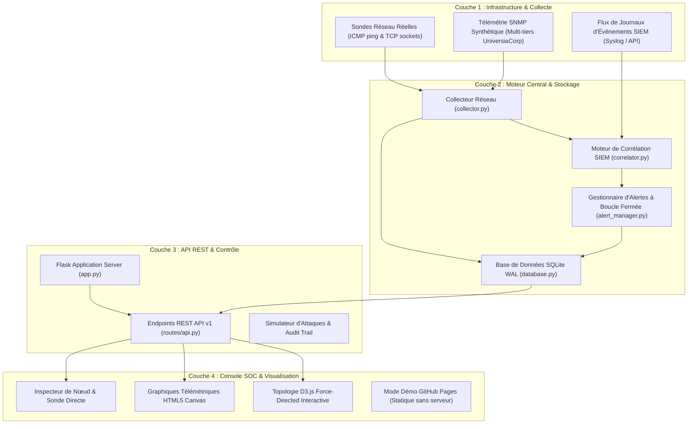

# NetSentinel Enterprise — Guide Pédagogique et Architectural

> **Document de Référence & Mentorat Technique**  
> **Auteur du Projet :** Mohammed Aichour  
> **Établissement :** UniversiaCorp / Universiapolis  
> **Version :** 2.4.0 (Enterprise NMS & SIEM)  
> **Langue :** Français

---

## 1. Introduction : Qu'est-ce que NetSentinel Enterprise ?

**NetSentinel Enterprise** est une plateforme unifiée combinant deux fonctions fondamentales de l'infrastructure informatique d'entreprise :
1. **Un NMS (Network Management System)** : Supervision télémétrique en temps réel de la performance réseau (latence RTT, perte de paquets, bande passante entrante/sortante, paquets par seconde, disponibilité des ports applicatifs TCP).
2. **Un SIEM (Security Information and Event Management)** : Moteur de corrélation d'événements de sécurité analysant les flux télémétriques et journaux d'accès pour détecter les cyberattaques selon le framework mondial **MITRE ATT&CK**, déclencher des alertes avec gestion de cycle de vie et orchestrer des actions de remédiation (quarantaine logicielle).

Le projet simule l'infrastructure réseau multi-tiers d'une entreprise mondiale (**UniversiaCorp**), tout en intégrant des capacités de **diagnostic réseau réel** (ping ICMP et sondes de ports TCP réels exécutés par le système d'exploitation).

---

## 2. Architecture Globale du Système

Le système est conçu selon une architecture en couches étanche et modulaire :

---

## 3. Ce qui est Réel vs Ce qui est Simulé (Honnêteté Technique)

Pour une soutenance académique ou un entretien technique, il est crucial d'expliquer avec précision ce qui fonctionne réellement et ce qui est modélisé :

| Composant | Statut | Description Technique |
| :--- | :--- | :--- |
| **Sonde ICMP (Ping)** | **RÉEL** | Utilise la commande ping native du système d'exploitation (`ping -n` sous Windows, `ping -c` sous Linux) via un sous-processus Python non bloquant. Mesure le vrai RTT en millisecondes et calcule la perte de paquets réelle. |
| **Sonde TCP Service** | **RÉEL** | Utilise les sockets Python (`socket.create_connection`) pour initier une véritable poignée de main TCP 3-way (`SYN -> SYN-ACK -> ACK`) contre l'IP et le port cibles avec timeout configurable. Distingue un port ouvert d'un refus de connexion (`WSAECONNREFUSED` / `ECONNREFUSED`). |
| **Topologie UniversiaCorp** | **SIMULÉ** | Les équipements (Firewall Palo Alto, Switch Spine Cisco Nexus, WAF Nginx, Serveur AD, Cluster PostgreSQL) sont des modèles de données représentatifs d'un réseau d'entreprise. Leurs métriques CPU, RAM et bande passante sont générées mathématiquement avec du bruit gaussien et sont honnêtement étiquetées `is_simulated: true`. |
| **Moteur SIEM Corrélateur** | **RÉEL** | Algorithmes réels de fenêtres temporelles glissantes (`sliding time window`), compteurs d'échecs, analyse de seuils volumétriques et vérification de listes blanches MAC. |
| **Cycle de Vie des Alertes** | **RÉEL** | Dégradation automatique de l'état du nœud (`ONLINE` → `CRITICAL` / `DEGRADED`), déduplication des alertes récurrentes, et restauration automatique de l'état nominal (`recompute_status`) lors de la résolution de l'incident. |
| **Isolation / Quarantaine** | **LOGICIEL** | Isolation au niveau de la couche applicative/routage NMS (bloque l'ingestion télémétrique de l'hôte et marque l'équipement en quarantaine) avec traçabilité complète dans la table `audit_log`. |

---

## 4. Les 5 Règles de Détection SIEM (MITRE ATT&CK)

### Règle SEC-R001 : Attaque SSH par Force Brute (MITRE T1110.001)
- **Principe :** Détecte lorsqu'une même adresse IP source génère un nombre excessif d'échecs d'authentification SSH contre une machine du réseau.
- **Paramètres :** Seuil de **5 échecs** dans une fenêtre glissante de **60 secondes**.
- **Action Déclenchée :** Alerte de sévérité `CRITICAL`, état de la machine cible basculé à `CRITICAL`.

### Règle SEC-R002 : Balayage Horizontal de Ports / Reconnaissance (MITRE T1046)
- **Principe :** Identifie un attaquant qui tente d'énumérer les services disponibles en sondant de multiples ports TCP sur une courte période.
- **Paramètres :** Seuil de **10 ports distincts** scannés par la même IP source en **30 secondes**.
- **Action Déclenchée :** Alerte de sévérité `HIGH`, état de l'hôte passé à `DEGRADED`.

### Règle SEC-R003 : Attaque DDoS Volumétrique SYN Flood (MITRE T1498.001)
- **Principe :** Analyse la télémétrie réseau des interfaces de périmètre pour détecter une saturation de la bande passante ou un pic anormal de paquets par seconde.
- **Paramètres :** Bande passante entrante > **800 Mbps** OU trafic > **40 000 paquets/seconde**.
- **Action Déclenchée :** Alerte de sévérité `CRITICAL`, pare-feu de bordure basculé à `CRITICAL`.

### Règle SEC-R004 : Détection d'Adresse MAC Illégitime / Rogue Device (MITRE T1200)
- **Principe :** Surveillance des trames de niveau 2 (liaison de données). Toute adresse MAC non répertoriée dans la table d'approbation d'entreprise (`AUTHORIZED_ENTERPRISE_MACS`) qui tente de se connecter sur un VLAN sensible (ex. VLAN-10-CORE) est immédiatement interceptée.
- **Action Déclenchée :** Alerte de sévérité `CRITICAL`, port du switch concerné isolé.

### Règle SEC-R005 : Instabilité de Liaison / Link Flapping & Rafale de Pertes (NMS-NET-01)
- **Principe :** Détecte les battements répétitifs d'interfaces réseau (câble fibre défectueux, oscillation de routage BGP/OSPF) ou une dégradation brutale de la qualité de transmission.
- **Paramètres :** Plus de **4 transitions d'état** (UP/DOWN) en **60 secondes**, OU perte de paquets > **10%** avec latence > **200 ms**.
- **Action Déclenchée :** Alerte de sévérité `MEDIUM`, équipement passé à `DEGRADED`.

---

## 5. Gestion de Données & Optimisations SQLite

Le backend utilise SQLite avec des pratiques d'ingénierie professionnelles :
1. **Mode WAL (Write-Ahead Logging) :** Activé via `PRAGMA journal_mode = WAL;`. Permet aux lecteurs de ne pas bloquer les scripteurs et inversement, évitant les erreurs de verrouillage sous Windows.
2. **Auto-Purge Télémétrique (Pruning) :** Pour éviter que le fichier `netsentinel.db` ne s'engorge lors d'une supervision continue, la méthode `TelemetryRepository.prune_old_samples()` conserve uniquement les 120 derniers échantillons par équipement (environ 30 minutes d'historique haute résolution).
3. **Auto-Découverte d'Actifs (SIEM Asset Auto-Discovery) :** Lorsqu'un événement de sécurité mentionne une adresse IP ou un équipement non encore catalogué, le système crée dynamiquement un enregistrement d'hôte `UNCLASSIFIED` avec statut de traçabilité, assurant l'intégrité référentielle sans interruption de service.

---

## 6. Guide de Présentation pour Soutenance / Entretien

Lors de la présentation du projet à un recruteur ou un jury d'ingénieurs :

1. **Montrer la console SOC :**
   - Mettre en avant la topologie interactive D3.js avec les 5 tiers (Périmètre, Cœur de réseau, DMZ, Services centraux, Bases de données).
2. **Exécuter une vraie sonde de diagnostic :**
   - Cliquer sur un équipement dans le tableau ou la topologie, puis sur **"Execute Live ICMP & TCP Probe"**.
   - Montrer les résultats réels retournés par les sockets de la machine (latence en ms, statut des ports TCP).
3. **Injecter une Cyberattaque :**
   - Ouvrir l'**Attack Simulator** et sélectionner une attaque (ex. *SSH Credential Brute-Force* ou *Rogue MAC Injection*).
   - Montrer l'apparition instantanée de l'alerte corrélée avec son identifiant MITRE ATT&CK et le passage de la cible en rouge (`CRITICAL`).
4. **Appliquer la remédiation :**
   - Utiliser le bouton **"Isolate / Quarantine Host"** pour appliquer une quarantaine logicielle.
   - Montrer dans l'onglet Audit la trace de conformité (`QUARANTINE_ENFORCE`).
   - Résoudre l'alerte (**"Resolve"**) et démontrer le rétablissement automatique de l'état nominal (`ONLINE`).
5. **Démontrer la couverture de tests :**
   - Ouvrir un terminal et exécuter `pytest -v` pour prouver que les 26 tests d'intégration et unitaires passent à 100%.
