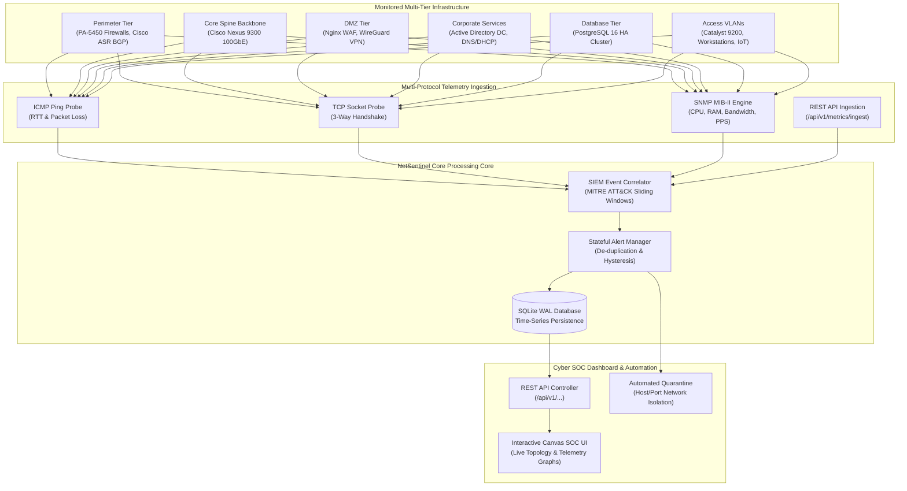
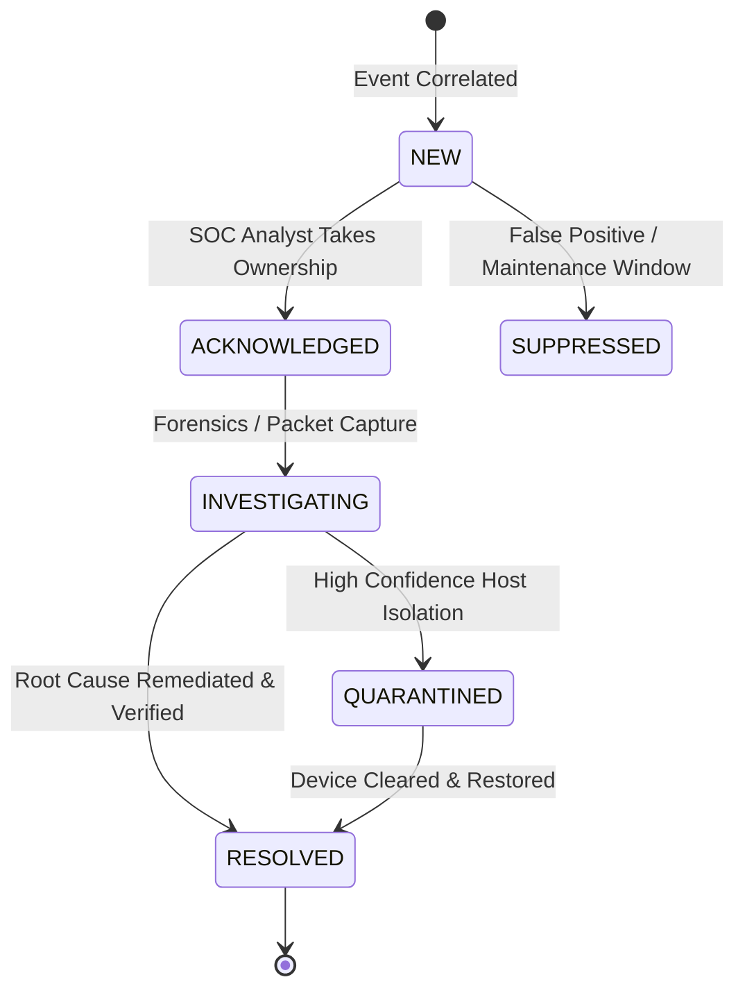

# NetSentinel Enterprise — Architectural Specification & Engineering Design

## 1. System Overview

**NetSentinel Enterprise** is a high-throughput Network Security & Telemetry Monitoring System (NMS & SIEM) engineered to provide unified visibility, threat detection, and incident response for large-scale corporate enterprise infrastructures.

---

## 2. SIEM Event Correlation Engine

The correlation engine maintains high-throughput in-memory sliding windows with automatic eviction. It maps behavioral anomalies directly to the **MITRE ATT&CK Matrix for Enterprise**:

| Rule ID | Threat Description | MITRE ID | Window | Threshold | Initial Severity |
| :--- | :--- | :--- | :--- | :--- | :--- |
| `SEC-R001` | SSH Credential Brute-Force | `T1110.001` | 60 sec | > 5 failed auths | `CRITICAL` |
| `SEC-R002` | Horizontal/Vertical Port Scan | `T1046` | 30 sec | > 12 unique ports | `HIGH` |
| `SEC-R003` | Volumetric DDoS / Traffic Anomaly | `T1498.001` | 30 sec | > 3.0x baseline BW or > 30k PPS | `CRITICAL` |
| `SEC-R004` | Rogue MAC on Sensitive VLAN | `T1200` | Real-time | ARP / MAC mismatch | `HIGH` |
| `SEC-R005` | Interface Flapping & Drop Burst | `NMS-NET-01` | 60 sec | > 4 state transitions | `MEDIUM` |

---

## 3. Stateful Alert Lifecycle & Incident State Machine

---

## 4. Database Schema Design (SQLite WAL Mode)

- `devices`: Master registry of all switches, firewalls, and server nodes.
- `topology_links`: Relational graph edges with bandwidth and operational state.
- `telemetry_samples`: Indexed time-series samples (`device_id`, `timestamp DESC`).
- `alerts`: Deduplicated alert registry with MITRE mappings and operator audit notes.
- `security_events`: Raw security log stream ingested from agents and network taps.
- `audit_log`: Append-only compliance log recording every operator acknowledgment and remediation action.
